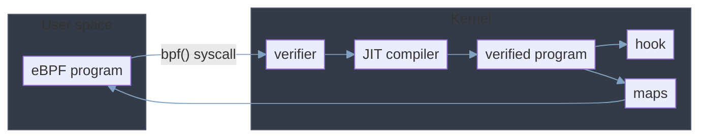
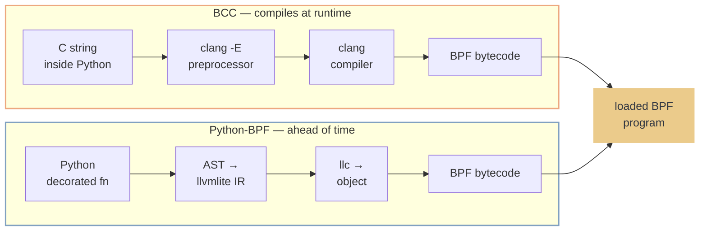
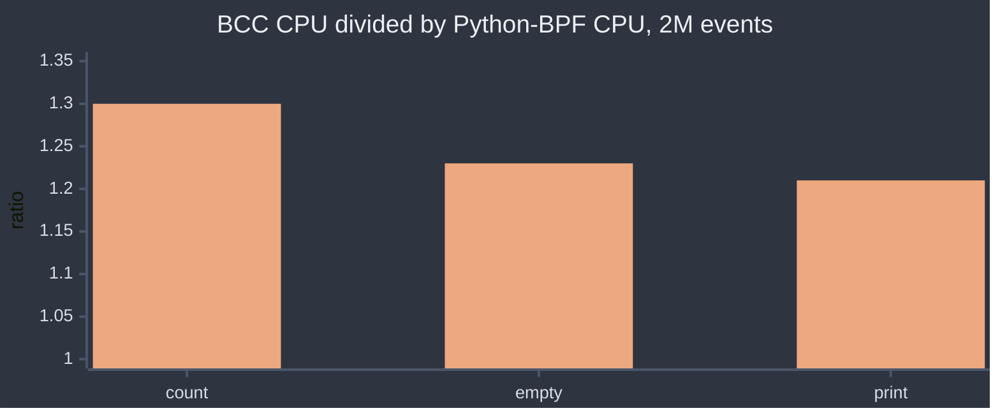

# Python eBPF: BCC C-String Runtime vs Python-BPF AST AOT

Nizar Akbar Meilani — DomaiNesia

PyCon Taiwan 2026

<!--
Welcome. Today we compare two Python eBPF frameworks — not just which is faster, but WHY. We measured every layer: startup syscalls, per-event CPU, memory, profiling, bytecode, JIT instructions. Both frameworks load a BPF program into the kernel — every performance difference lives in the userspace glue around it.
-->

---
layout: two-cols
---

# About Me

::left::

Systems engineer at **DomaiNesia** · Yogyakarta, Indonesia

- **Focus:** eBPF from Python — kernel observability without writing C
- **Recently:** Python wrappers for traffic filtering — utilizing **bpfilter**
- **Today:** PyCon ID 2026 · previously PyCon APAC 2024 · PyCon HK 2025 · PyCon ID 2025

::right::

[github.com/nizarakbar](https://github.com/nizarakbar)

[talk repo](https://github.com/nizarakbarm/pycon-tw-2026-bcc-vs-pythonbpf)

<!--
Quick intro. I'm a systems engineer at DomaiNesia — a hosting and cloud provider in Indonesia — building Python tooling for eBPF observability. My approach is data over assumptions, shaped by CTF reverse engineering. This talk is that approach applied to eBPF tooling.
-->

---
layout: default
---

# eBPF architecture overview



<!--
This is the frame for everything that follows. Two boxes: user space and kernel. Both tools sit in the first box, and both use one path in the second box: the same bpf() syscall, the same verifier, the same JIT compiler, the same hook, the same maps. The hook is a tracepoint because the workload is sys_enter_execve. Hold the shape: every measurement in this talk is taken in one of those two boxes, and once the kernel path is shared, any per-event difference has to come from user space. That is what the next slides measure, and it is why the deny gap later is a framework limit and not a kernel one.
-->

---
layout: default
---

# Architecture: How a Program Becomes Bytecode



**Consequence:** BCC needs `clang` + kernel headers on the host at runtime. Python-BPF needs neither once built.

<!--
Two architectures, one destination. BCC embeds C strings inside Python, forks clang at runtime, and compiles against kernel headers. Python-BPF parses a decorated Python function into an AST, lowers it to llvmlite IR, and compiles with llc — all ahead of time. Both paths end at the same place: a BPF program loaded into the kernel. The node at the end is the point of the slide: both paths load a BPF program into the kernel. Do not claim the bytecode is identical.
-->

---
layout: fact
---

# Two frameworks, three questions

**Where does state live?** → maps

**How does data reach userspace?** → perf event array

**How do you emit an event?** → submit

<!--
Before we compare, get the three questions straight. Where does state live — maps. How does data reach userspace — the perf event array. How do you emit an event — submit. Every framework spells these three things differently, and that spelling difference is most of what we are about to measure.
-->

---
layout: two-cols-header
---

# State: the HashMap

::left::

<span class="bcc">**BCC**</span> — C macro, compiled at runtime

```c
BPF_HASH(start, u32);   // key=u32, leaf=u64, size=10240

int probe(struct pt_regs *ctx) {
    u32 key = bpf_get_current_pid_tgid();
    u64 *val = start.lookup(&key);   // ptr to leaf
    if (val) start.update(&key, val);
    return 0;
}
```

::right::

<span class="pbpf">**Python-BPF**</span> — Python class, AOT

```python
@bpf
@map
def start() -> HashMap:
    return HashMap(key=c_uint32, value=c_uint64,
                   max_entries=10240)

@bpf
@section("tracepoint/...")
def probe(ctx):
    key = pid()
    val = start.lookup(key)          # value, not ptr
    if val: start.update(key, val)
    return 0
```

<!--
Same kernel map type — BPF_MAP_TYPE_HASH — and the same helpers, lookup and update. The spelling differs: BCC passes &key, the address, and returns a pointer into the map. Python-BPF passes the value and returns a copy. Remember that distinction — it sets up the struct-in-map limitation later.
-->

---
layout: two-cols-header
---

# Userspace channel: the perf event array

::left::

<span class="bcc">**BCC**</span> — `BPF_PERF_OUTPUT` + `perf_submit`

```c
BPF_PERF_OUTPUT(events);

struct data_t { u32 pid; u64 ts; char comm[16]; };

int hello(struct pt_regs *ctx) {
    struct data_t d = {};
    d.pid = bpf_get_current_pid_tgid();
    d.ts  = bpf_ktime_get_ns();
    events.perf_submit(ctx, &d, sizeof(d));
    return 0;
}
```

::right::

<span class="pbpf">**Python-BPF**</span> — `PerfEventArray.output`

```python
@bpf
@map
def events() -> PerfEventArray:
    return PerfEventArray(key_size=c_uint32,
                          value_size=c_uint32)

@bpf
@section("tracepoint/...")
def hello(ctx):
    d = ProcessEvent()
    d.pid = pid()
    d.ts  = ktime()
    events.output(d)     # sizeof() inferred
    return 0
```

<!--
Same channel, different spelling again. BCC: perf_submit, and you hand it the context and the size yourself. Python-BPF: events.output(d), and both are inferred from the struct's AST. That inference is convenient — and it is also where the per-event copy cost we measure later comes from.
-->

---
layout: default
---

# Same job, different spelling

| step | <span class="bcc">BCC</span> | <span class="pbpf">Python-BPF</span> |
|---|---|---|
| declare map | `BPF_HASH(start, u32)` | `HashMap(key=c_uint32, …)` |
| lookup | `map.lookup(&key)` → `u64*` | `map.lookup(key)` → value |
| update | `map.update(&key, &val)` | `map.update(key, val)` |
| emit | `events.perf_submit(ctx,&d,sizeof(d))` | `events.output(d)` |
| define event | `struct data_t {…}` | `@struct class Event: …` |
| userspace poll | `b.open_perf_buffer(cb)` + `perf_buffer_poll()` | `PerfEventArray::poll()` |

<!--
Everything above, side by side. Six rows, same job in each. Keep this table in mind — the rest of the talk is measuring what those spelling differences cost at two million events, and where they cost nothing at all.
-->

---
layout: default
---

# From BCC C-String to Python-BPF

<Editor
  session="with-map-execve"
  defaultFolder="experiment/with_map"
  openFile="experiment/with_map/pythonbpf/sys_enter_execve/map_1_perf_timed_count.py"
  :fontSize="12"
  hideMinimap hideActivityBar hideStatusBar
  disableInitialFocus preload
  class="h-[415px] w-full"
/>

<!--
Live. The IDE holds the Python-BPF equivalent of the program: the HashMap counter plus the perf event array for sys_enter_execve. Open the bcc folder beside it to compare. Run it and watch the event counter. This slide needs slidev dev; a static build shows a placeholder here.
-->

---
layout: default
---

# What happens between start and stop?

<v-clicks>

1. Does BCC get 2 s before the trigger?
2. Does Python-BPF get 1 s before the trigger?
3. Do the 0.5 s and 2 s waits do any work?
4. Does the trigger run at the same speed for both programs?

</v-clicks>

<!--
Before any result, look at the measurement itself. A run has four parts, and the two slides that used to sit here now live in this note.

The four parts:
| part | value |
| wait before the trigger | BCC 2 s, Python-BPF 1 s |
| trigger | measured |
| 0.5 s after the trigger | 0.5 s |
| 2 s after SIGINT | 2 s |

The answers, in order. Q1 and Q2: the waits are BCC 2 s and Python-BPF 1 s. Q3: the idle waits hold no work, they only drain and close the program. Q4: the trigger runs at the same speed for both programs.

Why the two waits differ. The wait before the trigger is a bash sleep we set for safety, not a measured cost. Each value sits well above that framework's init, 0.4 s and 0.02 s, so the program is up before the trigger fires. The rule: sleep longer than init. The gap between 2 s and 1 s is the start-time difference, not a harness cost. Source: experiment/scripts/rebenc_unprof.sh, the arm calls at the end of the file.

Three questions to ask out loud: which program starts faster; does the wait cover each program's own start time; why does BCC need more time to start. The next slide answers them.

Every number in this deck is CPU time, not wall time, because the trigger sets the pace.
-->

---
layout: default
---

# Which program starts faster?

| | BCC | Python-BPF |
|---|---|---|
| init CPU | 0.4 s | 0.02 s |
| child process | none | llc |
| header blocks | 20,768 | 160 |

BCC compiles C at runtime. Python-BPF does not.

<!--
The test data. BCC needs 0.4 s to start. Python-BPF needs 0.02 s. That is the start-time difference the two waits cover. The two rows below are the mechanism. BCC compiles the C in its own process, so it shows no child. Python-BPF forks one child, the llc compiler. At init BCC reads 20,768 blocks of kernel headers. Python-BPF reads 160. Ranges: BCC 0.375-0.580 s, Python-BPF 0.020-0.027 s.
-->

---
layout: default
---

# What do we run?

| item | value |
|---|---|
| tracepoint | `sys_enter_execve` |
| trigger | 2M `fork` + `execve` pairs |
| program | `map_1_perf_timed_count.py` |
| host | vmnono (3 CPUs) |

Both frameworks run the same program.

<!--
One workload for the talk: sys_enter_execve, driven by 2M fork-plus-execve pairs, on the map_1_perf_timed_count program - a HashMap counter plus a perf event. The trigger is sequential: fork, wait for the child, then fork again. That is why one event costs 0.7-0.9 ms and 2M events take 25-30 minutes. The host is vmnono with three CPUs. Both frameworks run the same program, so any difference belongs to the framework, not the program.
-->

---
layout: default
---

# How we run one arm

<Editor
  session="runner"
  defaultFolder="experiment"
  openFile="experiment/scripts/rebenc_unprof.sh"
  :fontSize="12"
  hideMinimap hideActivityBar hideStatusBar
  disableInitialFocus preload
  class="h-[415px] w-full"
/>

<!--
Live. The runner: one arm at a time. It starts the program, sleeps a pre-wait for safety, then waits until the program reports that it is polling before it fires the trigger. That gate matters - a fixed pre-sleep can expire before attach and lose the trigger's whole burst with no LOST line. After the trigger it drains for T, then sends SIGINT and waits for the program to exit. The two arm calls at the end pass 2 s for BCC and 1 s for Python-BPF. This slide needs slidev dev; a static build shows a placeholder here.
-->

---
layout: default
---

# What does the callback cost?

- **count** — prints one line
- **empty** — does nothing
- **print** — prints a constant

Same program. Only the callback changes.

<!--
Source: passes 1-3. Three callback variants of the same program. count prints one line, empty does nothing, print prints a constant. Only the callback changes between them.
-->

---
layout: default
---

# Both frameworks deliver every event

| | events delivered | trigger sent |
|---|---|---|
| BCC | 2,000,000 | 2,000,000 |
| Python-BPF | 2,000,000 | 2,000,000 |

Both frameworks delivered 2,000,000 events. Nothing was lost.

<!--
Source: 10-08, 10-10. All six 2M arms in results/unprofiled. The trigger sends N = 2,000,000, and both frameworks delivered every one, so nothing was lost and no arm printed LOST.

Watch the number. The log line reads 2000001, but that is the summary formula, not an event: both programs print sum(v + 1) per map entry, so the reported total is one above the counter. The map held 2,000,000. Say 2,000,000 on stage.

The harness warns and quarantines an arm that falls short of the trigger. Delivery is equal, so CPU is the only open question.
-->

---

# Python-BPF uses less CPU



2M events, vmnono, un-profiled pass. BCC 134.6, 103.3 and 111.2 s. Python-BPF 103.7, 84.0 and 92.3 s.

<!--
Data: results/unprofiled, 2M arms, [TIMING] Total CPU. BCC uses 1.30 times the CPU on count, 1.23 on empty, 1.21 on print. Absolute CPU: BCC 134.57, 103.28 and 111.24 s. Python-BPF 103.66, 84.04 and 92.30 s. These are CPU numbers, not wall. Wall agrees between the frameworks because the trigger sets the pace. One host, one instrument.
-->

---
layout: default
---

# An empty callback still costs more

| callback body | BCC CPU | Python-BPF CPU | ratio |
|---|---|---|---|
| `pass` | 103.3 s | 84.0 s | 1.23 |

The callback does nothing. BCC still spends 19.2 s more.

<!--
Data: results/unprofiled, 2M, abl_A_empty arm. The callback body is a bare pass. It prints nothing and reads no field. BCC still uses 103.3 s against Python-BPF's 84.0 s, a 19.2 s gap and a 1.23 ratio. Nothing in the callback can explain that gap, so the cost is in how each framework makes the call, not in what the callback does. That is the floor of the difference.
-->

---
layout: default
---

# Where the CPU time goes

| frame family, on the stack | BCC | Python-BPF |
|---|---|---|
| ctypes + libffi | 84.0% | 0% |
| clang | 0.4% | 0% |
| pybind11 | 0% | 92.6% |

`perf record`, 2M count arm. Share of sampled cycles with that frame anywhere on the stack.

<!--
Data: results/perfrecord, 2M count arm, folded stacks summed by PMU cycles, frame matched anywhere on the stack. BCC carries the ctypes and libffi bridge on 84.0 percent of sampled cycles. Python-BPF carries it on zero percent, and its own binding pybind11 on 92.6 percent. clang is on 0.4 percent of BCC stacks, its runtime compile, and zero on Python-BPF. The same three names hold in the other arms: ctypes on 70.8 and 75.3 percent for BCC, pybind11 on 89.3 and 91.2 percent for Python-BPF. Percentages compare only within this pass. The measure is presence on the stack, not leaf time.
-->

---
layout: default
---

# BCC calls gettid once per event

| syscall | BCC | Python-BPF |
|---|---|---|
| gettid | 1,907,735 | 3 |
| poll | 1,978,114 | 1 |
| total calls | 3,913,286 | 2,055,624 |
| calls per event | 1.96 | 1.03 |

`strace -f -T`, 2M count arm. Every syscall counted. Counts only, not durations.

<!--
Data: results/straceT, 2M count arm, rank files. BCC calls gettid 1,907,735 times, close to once per event, and polls 1,978,114 times. Python-BPF calls gettid 3 times, at startup only, and polls once. Total calls: BCC 3,913,286 against Python-BPF 2,055,624, which is 1.96 against 1.03 calls per event. Durations from this pass are not usable, because strace intercepts the syscall under study, so read counts only.
-->

---
layout: default
---

# Wall time shows no difference

| | BCC | Python-BPF | difference |
|---|---|---|---|
| wall | 1763.6 s | 1768.6 s | 5 s, 0.3% |
| CPU | 134.6 s | 103.7 s | 30.9 s, 30% |

The trigger sets the pace, not the framework.

<!--
Two findings on this slide. First the wall-versus-CPU gap. Second, one line that changed the result.

One line changed the result: Python-BPF flushed every print. Removing that cut its system time 39 percent. Total CPU fell 21 percent. Source: 10-08, a run outside the packaged tree; the six programs in results/ carry no flush=True and the dataset README records the removal for this reason.

Data: results/unprofiled, 2M count arm, [TIMING]. Wall is 1763.6 s for BCC and 1768.6 s for Python-BPF, a 5 s gap, 0.3 percent. CPU is 134.6 s against 103.7 s, a 30.9 s gap, 30 percent. The trigger is a sequential fork and wait loop, about 0.7 ms per event, so it runs for about 24 minutes and both frameworks sit behind it. Wall therefore measures the trigger, not the framework.
-->

---
layout: default
---

# Three ways to get this wrong

| trap | what it does | evidence |
|---|---|---|
| a long drain | adds CPU that is not the event | `T=15` at N=2000 fell to `T=0.5` |
| the profiler | roughly doubles the CPU it measures | 134.6 s becomes 242.9 s |
| small N | measures startup, not per-event cost | 2.1x at N=2000, 1.30x at 2M |

Every number in this talk is CPU time, at 2M events.

<!--
Data: results/unprofiled. A drain longer than the work it drains adds CPU that is not the event: the T=15 drain at small N was about 30 times larger than the work it drained, and correcting it to T=0.5 dropped poll CPU and widened the gap. The profiler unwinds in the target's own context, so pass 3 absolute CPU sits about 80 percent above pass 1: 134.6 s un-profiled against 242.9 s under perf record, both BCC count at 2M. Small N measures the amortisation curve, not per-event cost: about 2.1x at N=2000 against 1.30x at 2M.
-->

---
layout: section
---

# Limitations

Seven gaps in Python-BPF, and one open question.

---
layout: default
---

# Limitation 1 — Python-BPF cannot deny a syscall

| mechanism | Python-BPF |
|---|---|
| BPF-LSM program | no |
| `bpf_override_return` | no |
| `bpf_send_signal` | no |

Enforcement runs outside the program.

<!--
Source: 10-10. Python-BPF has no way to deny a syscall inside the kernel. It cannot attach a BPF-LSM program, cannot call bpf_override_return, and cannot call bpf_send_signal. The end-to-end GhostLock demo on vmnono shows this: the tracker is a BPF program, and the enforcement is a userspace SIGKILL. XDP drop is the only honoured verdict. So enforcement runs outside the program.
-->

---
layout: default
---

# Limitation 2 — A kill is not a block

| stop method | when it acts |
|---|---|
| userspace kill | after the syscall |
| seccomp filter | before it |

The vulnerable path already ran.

<!--
Source: 10-10. A userspace kill acts after the syscall returns. A seccomp filter acts before it. So a kill cannot block the syscall that is already running, and the vulnerable path has already run by the time the process dies. That is the difference between stopping a process and denying an action.
-->

---
layout: default
---

# Limitation 3 — Two sections, one register struct

`struct_pt_regs` contains **union** members. Two sections that share it break the debug metadata.

| sections with `struct_pt_regs` | result |
|---|---|
| one | compiles |
| two | debug metadata recurses |

<v-click>

`RecursionError` in `function_debug_info.py:73`.

Workaround: **one section per file.** `kprobe` and `kretprobe` cannot share a file.

</v-click>

<!--
The cause, in one sentence: struct_pt_regs contains union members, and two sections that share it create circular debug metadata, so the compiler recurses.

Click 1: the failure and the workaround. RecursionError raised in function_debug_info.py line 73. The workaround is one section per file, which is why every GhostLock program holds a single section.

Source: "Python-BPF All Workarounds for struct_pt_regs with Multiple Sections", 2026-05-18, Python-BPF alpha. That note lists five workarounds and recommends one section per file for immediate use, and a union check in function_debug_info.py as the proper fix.

One caution. The note records a compile-time RecursionError. Disksnoop, which is two sections on the same struct, was later observed to load and attach and print wrong values instead. That is a second, quieter failure of the same shape. Do not claim the limit is gone: writing IR is not running correctly. If asked which form you will see, say the compile-time crash is the documented one and the silent wrong-value run is the one we hit on 0.2.0.
-->


---
layout: default
---

# Limitation 4 — Python-BPF cannot read a kernel string

`ctx.si` holds a `struct filename *`. Three attempts to read its name:

| attempt | helper | result |
|---|---|---|
| read `struct filename.name` | `probe_read` | `Struct type … not found` |
| read into a local `str(256)` | `probe_read_str` | `Variable 'buf' not found` |
| read into `c_uint64` | `probe_read_str` | 8 bytes — truncates |

<v-click>

What works reads the **pointer, not the string**: `probe_read(name_str, 8, fname_ptr)` → `0xffff8f2d4705c000`, a valid kernel address.

</v-click>

<v-click>

**Not garbage — the second dereference is missing.** `probe_read` gives an `i64`; `probe_read_str` wants an `i8*`. No `inttoptr` between them.

</v-click>

<!--
Ask the room: what does ctx.si hold here? A struct filename pointer, the second argument register.

The table is the three documented attempts, each with its real error. First row: cast to the vmlinux struct type and read its name field, probe_read reports Struct type not found, because vmlinux ctypes stubs are not registered in the compiler's struct symbol table. Second row: allocate a local @struct with a str(256) field and read into it, ValueError Variable 'buf' not found, because the struct constructor never registers the variable in the local symbol table. Third row: a c_uint64 buffer, which compiles and reads only 8 bytes, so a filename truncates.

Click 1: the only thing that works. probe_read with an 8 byte destination returns the struct's name pointer, 0xffff8f2d4705c000, which is a valid kernel address in the 0xffff8 range. So the helper works and the read succeeds.

Click 2: the correction, and the reason this slide used to be wrong. The title of the source note says "returns garbage", and the note itself says that title is wrong. The value is a valid pointer. What is missing is the second dereference: probe_read leaves a loaded i64, and probe_read_str wants an i8* pointer, so the emitter would need to insert inttoptr. It does not, and that is the gap.

Source: "Python-BPF Probe Read of ctx.si Returns Garbage", 2026-07-25, measured on Python-BPF 0.1.9. BCC does this in one C expression: (struct filename *)PT_REGS_PARM2(ctx) then fname->name, because clang emits the offset dereference for you.
-->

---
layout: default
---

# Limitation 5 — Two gaps in the translator

| construct | what happens |
|---|---|
| `ctx.args[0]` | falls through, no code emitted |
| `count += 1` | a plain add, not atomic |

A map counter can lose updates.

<!--
Source: 2026-05-11, last audited 2026-05-10, spoken here as a live limit. An array subscript falls to a bare return at expr_pass.py line 730, so no code is emitted for ctx.args[0]. The addition operator maps to a plain builder add at line 227, so count plus one compiles to load, add, store, with a race window between load and store. BCC emits a single atomicrmw with sequential consistency for the same line. So on many CPUs a Python-BPF map counter can lose updates. Both are compiler gaps, not design limits.
-->

---
layout: default
---

# Any other limitation?

What else have you hit with Python-BPF?

<!--
Open question for the room. The slides above carry six limits, all live: write through a map-value struct, no in-kernel deny helper, the kill-versus-block gap, the silent codegen traps, no two-step kernel read, and two sections on one register struct. One more note is still off the deck: no buffer arrays inside a BPF function, which blocks payload matching and is why the GhostLock programs read scalar registers only. Ask the room what else they have hit. Listen, do not defend.
-->

---
layout: default
---

# Is this Python-BPF, or the kernel?

| program shape | trace output |
|---|---|
| one `print`, three values | works |
| four or more values in one call | silent |

<v-click>

**Both frameworks. It is a kernel rule.**

`bpf_trace_printk` takes three values after the format string.

</v-click>

<v-click>

The count is not the finding. **The silence is.**

Python-BPF loads, attaches, drops the line, and says nothing.

</v-click>

<!--
Ask the room before advancing: a print with four values goes silent. Is that Python-BPF, or the kernel? Pause.

Click 1: reveal. It is the kernel, and both frameworks are subject to it. bpf_trace_printk takes three values after the format string, and the rule comes from the helper signature: fmt plus fmt_size plus three varargs is five, the eBPF helper argument cap. A framework that tried to print four would fail the verifier, so no framework lifts this. Source: the 2026-10-14 note "BCC vs pythonbpf bpf_trace_printk maximum payload", and linux/bpf.h, which states the helper "can take up to three additional u64 arguments (as an eBPF helpers, the total number of arguments is limited to five)."

Click 2: the part that belongs in a talk about Python-BPF. The count is not the finding, the silence is. BCC fails at load with the BPF stack-limit error and the compiler names the fix. Python-BPF loads, attaches, drops the line, and says nothing at all. That is the difference worth saying out loud.

An earlier reading of this slide said a program with eight context fields, or five separate print statements, goes silent. That is evidence.txt section 4, measured while building the GhostLock tracker, and it does not separate two causes. The measured kernel rule is the four-value case, so state that and not the other.
-->


---
layout: default
---

# Where each framework wins

| axis | BCC | Python-BPF | why |
|---|---|---|---|
| startup CPU | 0.45 s | 0.02 s | BCC compiles C at runtime |
| per-event CPU | 134.6 s | 103.7 s | ctypes and clang cost cycles |
| syscalls per event | 1.96 | 1.03 | one gettid per event in BCC |
| peak RSS | 175 MB | 22 MB | clang loaded in the BCC process |

<!--
Data: results/unprofiled and results/straceT, 2M count arm. Startup CPU is 0.45 s against 0.02 s, because BCC forks clang and reads kernel headers at run time. Per-event CPU is 134.6 s against 103.7 s. Syscalls per event: BCC 3,913,286 over 2M events is 1.96; Python-BPF 2,055,624 over 2M is 1.03. Peak RSS is 175 MB against 22 MB, because clang is loaded in the BCC process while Python-BPF forks one child that exits.
-->

---
layout: default
---

# What to choose

| pick Python-BPF | pick BCC |
|---|---|
| startup: 0.02 s against 0.45 s | a struct as a map value works today |
| CPU at 2M: 1.30x lower | |
| syscalls: 1.03 against 1.96 per event | |
| memory: 22 MB against 175 MB | |

Boundary: Python-BPF cannot deny a syscall in the kernel.

<!--
The choice, from the October numbers only. Python-BPF wins startup, per-event CPU, syscalls per event and memory. BCC wins one thing today: a struct as a map value compiles in BCC and fails in Python-BPF. The boundary matters as much as the wins: Python-BPF cannot deny a syscall in the kernel, so it cannot enforce. For a deny job, choose a tool that can. For measurement, choose Python-BPF.
-->

---
layout: center
---

# Q&A

Slides, dataset and scripts: [github.com/nizarakbarm/pycon-tw-2026-bcc-vs-pythonbpf](https://github.com/nizarakbarm/pycon-tw-2026-bcc-vs-pythonbpf)

Python-BPF: [github.com/python-bpf/python-bpf](https://github.com/python-bpf/python-bpf) · BCC: [github.com/iovisor/bcc](https://github.com/iovisor/bcc)

<!--
Thank you. Ten to fifteen minutes for questions. The dataset is in the talk repository: results/unprofiled, results/straceT and results/perfrecord, with a README that records how to read each pass. Happy to take questions on the methodology, the limitations, or the harness.
-->
